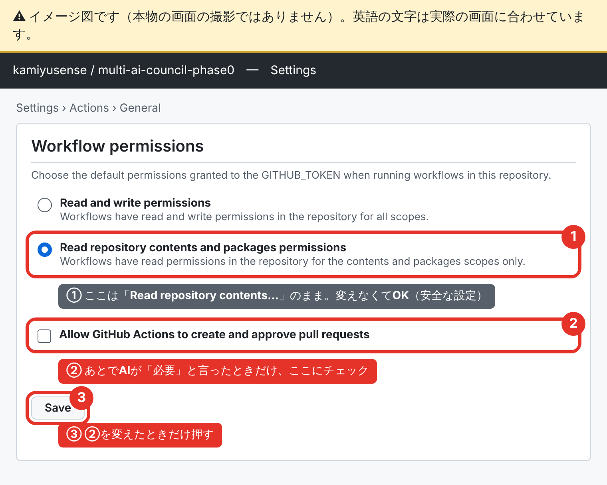

# S3 最初の設定と「承認」コメントの試し（相棒向けガイド）

計画: [`RELAY_TOWER_PLAN_V4_JA.md`](RELAY_TOWER_PLAN_V4_JA.md) の S3。

## 1. 結論：GitHub の設定は、今は変えなくていい

- 当初は「Actions の設定2つ」が必要と考えていたが、調べた結果、**今の段階では設定の変更は不要**。
  - Actions（GitHub の自動作業係）は、ワークフローのファイルに「この作業だけ書き込んでいい」と1つずつ書けば、その範囲だけ書き込める。リポジトリ全体の初期設定を「書き込みOK」に広げる必要はない。
  - 実際に、既存の掲示板更新ワークフロー（`.github/workflows/loop-status-development.yml`）はこの書き方で Issue #33 を更新してきた。
  - 正式な記録は PR ではなく専用ブランチに直接書く設計にするので、「Actions が PR を作る許可」も今は要らない。
- 今の設定値そのものは、AI からは読めない（GitHub が AI にその画面の読み取りを許していない）ので **UNKNOWN**。変えないなら確認も不要。
- 将来「Actions に PR を作らせる」設計になったときだけ、下の画像の ② にチェックを入れる。その時はあらためて声をかける。

### 設定画面（イメージ図）

- 直接開くURL: https://github.com/kamiyusense/multi-ai-council-phase0/settings/actions
- ページを一番下までスクロールすると「Workflow permissions」がある。
- ① は今のまま（安全な設定）。② と ③ は、AI が必要と言ったときだけ。
- この画像は説明用のイメージ図で、本物の画面の撮影ではない。英語の文字は実際の画面に合わせてある。

## 2. 「承認」コメントの試し（相棒の作業は2つ）

試し用の Issue: [#459](https://github.com/kamiyusense/multi-ai-council-phase0/issues/459)。ここに書いたコメントは何の承認にも使わない。

1. スマホの GitHub アプリで #459 を開き、本文が承認の2文字だけのコメントを1件書く。
2. 書いたコメントに 👍 を1つ付ける。

あわせて Grok Bot に、#459 へ `AI-Agent: grok` 付きのテストコメントを1件書いてもらう（頼む文章はチャットで渡す）。

## 3. Claude が確かめること（読むだけ）

| 確かめること | なぜ |
|---|---|
| 相棒のスマホからのコメントの `performed_via_github_app`（どのアプリ経由で書いたか） | AI の書き込みと見分ける補助になるか |
| Grok Bot（Cursor 連携経由）のコメントの `performed_via_github_app` | 同上 |
| 👍 を付けたあとに `updated_at` が変わるか | 変わるなら「編集された」と誤判定するので、判定のやり方を直す |
| S2 の判定部品の結果 | 相棒のコメントだけが「承認」と判定され、Grok Bot のものは外れるか |

わかっていること（2026-10-23 確認）: Claude がプロジェクトスレッドから書いたコメントは、`performed_via_github_app` が `claude` になっている（Issue #346 のコメントで確認）。

結果は [`S3_APPROVAL_TEST_RESULT.md`](S3_APPROVAL_TEST_RESULT.md) に記録した（2026-10-23）。
